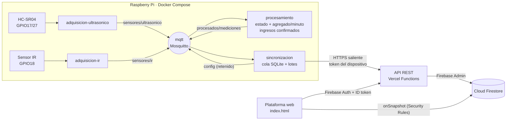

# Estacionamiento inteligente — Solemne 1, Infraestructura TI

Sistema IoT que detecta si un puesto de estacionamiento está **libre u ocupado** y
cuenta los **ingresos de vehículos**, combinando un sensor ultrasónico HC-SR04 y un
sensor infrarrojo de obstáculos conectados a una Raspberry Pi. Los datos se
procesan en microservicios Docker, se envían por HTTPS a una API en Vercel y se
guardan en Cloud Firestore. La plataforma web muestra datos en tiempo real,
históricos, alertas y permite administrar organizaciones, usuarios y dispositivos.

- **Plataforma pública:** https://solemne-1-ti.vercel.app
- **Repositorio:** https://github.com/Matias2004-cmd/Estacionamiento-Inteligente

| Documento | Contenido |
| --- | --- |
| [raspberry/README.md](raspberry/README.md) | Conexión del hardware, instalación y operación de los microservicios en la Pi |
| [docs/evaluacion-uso.md](docs/evaluacion-uso.md) | Evaluación de uso y capacidad (requisito 5): estimación, medición, límites, optimizaciones, proyección y migración |
| [docs/bitacora-recoleccion.md](docs/bitacora-recoleccion.md) | Bitácora del periodo de recolección y evidencias observadas |

## Arquitectura



| Capa | Dónde | Responsabilidad |
| --- | --- | --- |
| Presentación | [index.html](index.html) | Dashboard público y privado, históricos, alertas y administración |
| Lógica de negocio | [api/](api/) | Validación de mediciones, roles, organizaciones, tokens de dispositivo |
| Acceso a datos | [lib/api-auth.js](lib/api-auth.js) + Firebase Admin | Conexión a Firestore, autenticación de usuarios y dispositivos |

### Microservicios en la Raspberry Pi

| Contenedor | Responsabilidad única | Comunicación |
| --- | --- | --- |
| `mqtt` | Broker que desacopla productores y consumidores | Puerto 1883 solo en `127.0.0.1` |
| `adquisicion-ultrasonico` | Lee el HC-SR04 con el intervalo configurado | Publica `sensores/ultrasonico`; escucha la configuración |
| `adquisicion-ir` | Detecta el paso de vehículos por la entrada | Publica `sensores/ir` |
| `procesamiento` | Valida, aplica histéresis LIBRE/OCUPADO, combina sensores y agrega por minuto | Consume `sensores/*`, publica `procesados/mediciones` |
| `sincronizacion` | Cola local SQLite, envío por lotes HTTPS y consulta de configuración remota | Consume `procesados/mediciones`, publica la configuración retenida |

Ningún servicio lee los datos de otro: todo pasa por tópicos MQTT. Cada
contenedor tiene `restart: unless-stopped` y un healthcheck basado en un
"latido" que el propio bucle principal actualiza, por lo que un servicio colgado
aparece `unhealthy`.

### Información combinada de los sensores

- **Estado del puesto** (ultrasónico): distancia promedio con histéresis y tres
  lecturas consecutivas para evitar oscilaciones.
- **Ingreso confirmado** (IR + ultrasónico): un evento IR seguido de que el
  puesto pase a `OCUPADO` dentro de `VENTANA_INGRESO_SEGUNDOS` (60 s). Los
  eventos IR que no terminan en ocupación se descartan como tránsito o ruido.
- **Ocupación %** de la última hora e **ingresos confirmados** se muestran en
  el panel de la organización.

## Estructura del repositorio

```text
api/                     Endpoints REST (Vercel Functions)
lib/api-auth.js          Firebase Admin, autenticación de usuarios/dispositivos, errores
index.html               Plataforma web (pública + privada)
firestore.rules          Security Rules por organización y rol
firestore.indexes.json   Índices y exenciones de índice
raspberry/               Microservicios, Dockerfile y docker-compose.yml
scripts/                 Verificación, exportación, medición de uso y proyección de costos
docs/                    Evaluación de uso y bitácora
```

## Modelo de datos (Cloud Firestore)

```text
organizaciones/{organizacionId}
  ├─ nombre, creadaEn
  ├─ miembros/{uid}            uid, email, role: "admin" | "operator"
  ├─ dispositivos/{dispositivoId}
  │     nombre, tipo, activo, publicarEnDemo, configuracion{...},
  │     ultimoContacto, ultimaMedicion{...}
  └─ mediciones/{dispositivoId}__{dispositivoId}_{epochMinuto}
        sensorId, periodoInicio, estado, distanciaCm, distanciaMinCm,
        distanciaMaxCm, muestras, deteccionesIr, ingresosConfirmados, timestamp
credencialesDispositivo/{sha256(token)}   organizacionId, dispositivoId, revoked
mediciones/{id}                           copia pública opcional para la demo
```

| Decisión | Justificación |
| --- | --- |
| Un documento **por minuto** con promedio, mínimo, máximo y conteos | 1.440 escrituras/día por dispositivo en vez de 17.280 (una por lectura cada 5 s) |
| ID determinista `dispositivo_minuto` | Los reintentos sobrescriben el mismo documento: **sin duplicados** |
| Subcolección por organización | Aislamiento natural en Security Rules y consultas acotadas a una organización |
| `ultimaMedicion` dentro del dispositivo | El estado actual se obtiene leyendo 1 documento |
| Credencial guardada como hash SHA-256 | Si se filtra la base no se filtran los tokens; revocar = `revoked: true` |
| Índices solo en `periodoInicio` y `sensorId` | Son los únicos campos consultados; el resto está exento ([firestore.indexes.json](firestore.indexes.json)) y reduce ~70 % el almacenamiento |

Consultas que realiza la plataforma:

| Consulta | Índice |
| --- | --- |
| Mediciones de la organización ordenadas por `periodoInicio desc`, `limit 100` (tiempo real) | Simple automático en `periodoInicio` |
| Histórico por rango `periodoInicio >= desde AND <= hasta`, paginado con cursor | Simple automático en `periodoInicio` |
| Organizaciones de un usuario: `collectionGroup("miembros").where("uid", "==", uid)` | Simple con alcance de grupo de colecciones (definido en `fieldOverrides`) |
| Credenciales de un dispositivo: `where("dispositivoId", "==", id)` | Simple automático |

## API REST

Base: `https://solemne-1-ti.vercel.app`. Todas las respuestas son JSON; los
errores tienen la forma `{"error": "mensaje"}`.

| Método y ruta | Autenticación | Función |
| --- | --- | --- |
| `GET /api/configuracion-publica` | Pública | Configuración web de Firebase (clave pública del cliente) |
| `GET /api/mediciones?limit&from&to&cursor` | Pública | Página de la colección de demostración (caché 60 s en el edge) |
| `GET /api/mediciones?scope=organizacion&organizacion=<id>&...` | ID token + miembro | Histórico paginado de la organización |
| `POST /api/mediciones` | Token del dispositivo | Guarda 1–100 agregados validados en su organización |
| `GET /api/configuracion-dispositivo` | Token del dispositivo | Configuración vigente del dispositivo |
| `GET /api/sesion` | ID token | Organizaciones y rol del usuario |
| `POST /api/iniciar-organizacion` | ID token del admin inicial | Crea la primera organización (variables `BOOTSTRAP_*`) |
| `POST /api/organizaciones` | ID token, rol admin | Crea otra organización |
| `GET/POST/PATCH/DELETE /api/dispositivos` | Miembro (GET) / admin | Alta, configuración, renovación y revocación de tokens |
| `GET/POST/PATCH/DELETE /api/usuarios` | Admin | Miembros y roles de la organización |

Ejemplos:

```bash
# Envío de un lote desde la Raspberry (lo hace el servicio sincronizacion)
curl -X POST https://solemne-1-ti.vercel.app/api/mediciones \
  -H "Authorization: Bearer $TOKEN_DISPOSITIVO" -H "Content-Type: application/json" \
  -d '{"records":[{"recordId":"raspberry-pi-1_1792782000","sensorId":"raspberry-pi-1",
       "periodoInicio":"2026-10-23T19:00:00Z","distanciaCm":12.4,"distanciaMinCm":11.9,
       "distanciaMaxCm":13.0,"muestras":12,"deteccionesIr":1,"ingresosConfirmados":1,
       "estado":"OCUPADO"}]}'
# 201 {"ids":["raspberry-pi-1__raspberry-pi-1_1792782000"],"saved":true,"count":1,"scope":"organizacion"}

# Configuración vigente del dispositivo
curl https://solemne-1-ti.vercel.app/api/configuracion-dispositivo -H "Authorization: Bearer $TOKEN_DISPOSITIVO"
# 200 {"deviceId":"raspberry-pi-1","settings":{"distanciaLibreCm":23,"intervaloMuestreoSegundos":5,
#      "umbralAlertaCm":20,"tiempoDesconexionSegundos":600}}

# Histórico privado (ID token de Firebase Auth del usuario)
curl "https://solemne-1-ti.vercel.app/api/mediciones?scope=organizacion&organizacion=$ORG&from=2026-10-22T00:00:00Z&limit=100" \
  -H "Authorization: Bearer $ID_TOKEN"
# 200 {"records":[...],"nextCursor":"eyJwZXJpb2Rv..."}

# Cambiar la configuración de un dispositivo (admin)
curl -X PATCH https://solemne-1-ti.vercel.app/api/dispositivos -H "Authorization: Bearer $ID_TOKEN" \
  -H "Content-Type: application/json" -d '{"organizacion":"'$ORG'","dispositivoId":"raspberry-pi-1",
  "configuracion":{"distanciaLibreCm":25,"intervaloMuestreoSegundos":10,"umbralAlertaCm":20,"tiempoDesconexionSegundos":600}}'
# 200 {"saved":true}
```

Validaciones de `POST /api/mediciones`: `distanciaCm` 0–200, `estado` `LIBRE|OCUPADO`,
`sensorId` igual al dispositivo del token, `min ≤ promedio ≤ max`, conteos
enteros 0–10.000, `recordId` único por lote. `tiempoDesconexionSegundos` debe
superar el intervalo + 360 s para no alertar durante el envío por lotes.

## Seguridad

- La Raspberry **solo inicia conexiones HTTPS salientes**; no abre puertos (MQTT
  escucha en `127.0.0.1`) ni usa túneles.
- La cuenta de servicio de Firebase existe **solo** como variable de entorno en
  Vercel (`FIREBASE_SERVICE_ACCOUNT_JSON`). Nunca en la Pi ni en el repositorio
  (`.gitignore` bloquea `serviceAccount*.json` y `*-firebase-adminsdk-*.json`).
- Cada dispositivo tiene **su propio token** (32 bytes aleatorios), generado en
  el panel, mostrado una sola vez, guardado como hash y **revocable** o renovable.
- En la Pi el token es un secreto de Docker montado en `/run/secrets`, fuera del
  código y de la imagen.
- **Security Rules** ([firestore.rules](firestore.rules)): el navegador no puede
  escribir; solo lee los datos de organizaciones donde es miembro con rol
  `admin` u `operator` y correo verificado.
- Roles: `admin` administra organizaciones, dispositivos y usuarios; `operator`
  consulta dashboard, históricos y alertas.

## Despliegue desde cero

### 1. Firebase (plan Spark, sin tarjeta)

1. Crea el proyecto y una base Firestore en modo producción (este proyecto usa
   `southamerica-west1`).
2. **Authentication → Sign-in method:** habilita *Correo electrónico/contraseña*
   y agrega el dominio de Vercel a *Dominios autorizados*.
3. Registra una app web y copia `apiKey` y `appId`.
4. **Configuración → Cuentas de servicio → Generar clave privada.** Guarda el
   JSON **fuera del repositorio** (por ejemplo `C:\claves\estacionamiento.json`).
5. Publica reglas e índices:
   ```bash
   npm install -g firebase-tools
   firebase login
   firebase use estacionamiento-intelige-f3038
   firebase deploy --only firestore:rules,firestore:indexes
   ```

### 2. Vercel (plan Hobby)

1. Importa el repositorio de GitHub en Vercel (sin framework, raíz del repo).
   Cada push a `main` despliega automáticamente.
2. Variables de entorno (Production):

   | Variable | Valor |
   | --- | --- |
   | `FIREBASE_SERVICE_ACCOUNT_JSON` | Contenido completo del JSON de la cuenta de servicio |
   | `FIREBASE_PROJECT_ID` | `estacionamiento-intelige-f3038` |
   | `FIREBASE_WEB_API_KEY` / `FIREBASE_WEB_APP_ID` | Datos de la app web |
   | `BOOTSTRAP_ADMIN_EMAIL`, `BOOTSTRAP_ORGANIZATION_ID`, `BOOTSTRAP_ORGANIZATION_NAME` | Solo para crear la primera organización; bórralas después |
   | `API_TOKEN` | *(Opcional, legado)* token global que escribe solo en la demo pública. Déjala vacía para desactivarlo |

3. Si activas *Deployment Protection*, crea un *Protection Bypass for
   Automation* y guárdalo en la Pi como `vercel-bypass.txt`.

### 3. Primer administrador y dispositivo

1. Crea tu usuario en Firebase Authentication, verifica el correo e inicia
   sesión en la plataforma → **Configurar organización inicial**.
2. En **Dispositivos**, crea `raspberry-pi-1` y copia el token (se muestra una vez).
3. En **Usuarios y roles**, agrega un operador para la cuenta de prueba de consulta.

### 4. Raspberry Pi

Sigue [raspberry/README.md](raspberry/README.md).

### Desarrollo local

```bash
npm ci
npm run check          # verificación sin credenciales
npx vercel dev         # API + web en http://localhost:3000 (usa variables de .env.local)
```

## Checklist de la demostración (rúbrica, criterio 7)

1. **Datos en tiempo real:** panel privado abierto; mover un objeto frente al
   HC-SR04 y ver el cambio LIBRE → OCUPADO (y el aviso emergente) en ≤ 6 min
   (1 min de agregación + lote de 5).
2. **Cambio de configuración:** editar *Intervalo* o *Distancia libre* en el
   panel y mostrar en `docker compose logs -f adquisicion-ultrasonico procesamiento`
   el mensaje `Remote ... updated` (≤ 60 s), sin reiniciar nada.
3. **Recuperación tras desconexión:** apagar el hotspot 3–5 min, mostrar la cola
   (`registros pendientes > 0`), reconectar y ver `Uploaded batch`; los
   documentos aparecen sin duplicados (ID por minuto).
4. **Estado de los microservicios:** `docker compose ps` con los 5 contenedores `healthy`.
5. **Aislamiento:** iniciar sesión con un usuario de otra organización y mostrar
   que no ve los dispositivos ni las mediciones; intentar leer por consola de
   Firestore desde el navegador devuelve `permission-denied`.

## Solución de problemas

| Síntoma | Causa y solución |
| --- | --- |
| `/api/mediciones` responde 500 y Firestore dice `Quota exceeded` | Se agotó la cuota diaria gratuita. Se restablece a medianoche hora del Pacífico (≈ 04:00 en Chile con horario de verano). Mientras tanto la Pi guarda las lecturas en la cola SQLite y las reenvía después. Evita exportaciones completas o recargas masivas del panel. |
| `/api/sesion` responde 500 | Falta el índice de grupo de colecciones `miembros.uid`: `firebase deploy --only firestore:indexes` |
| El panel privado dice *permission-denied* | Reglas no publicadas o el usuario no tiene correo verificado/rol |
| `sincronizacion` registra HTTP 401 | Token revocado o mal copiado en `api-token.txt`; renueva la credencial en el panel |

## Scripts de apoyo

Todos leen la cuenta de servicio desde `--credencial <ruta fuera del repo>`,
`GOOGLE_APPLICATION_CREDENTIALS` o `FIREBASE_SERVICE_ACCOUNT_JSON`.

| Comando | Uso |
| --- | --- |
| `npm run check` | Verificación local sin credenciales |
| `npm run uso -- --credencial C:\claves\sa.json --organizacion <id> --dias 8` | Documentos por día y almacenamiento estimado (usa `count()`, casi no consume lecturas) |
| `npm run exportar -- --credencial ... --organizacion <id> --desde <ISO> --hasta <ISO>` | Exporta a CSV/JSON en `exportaciones/` (1 lectura por documento) |
| `npm run proyeccion` | Tabla de proyección de consumo y costos para 1/10/100/1.000 dispositivos |
